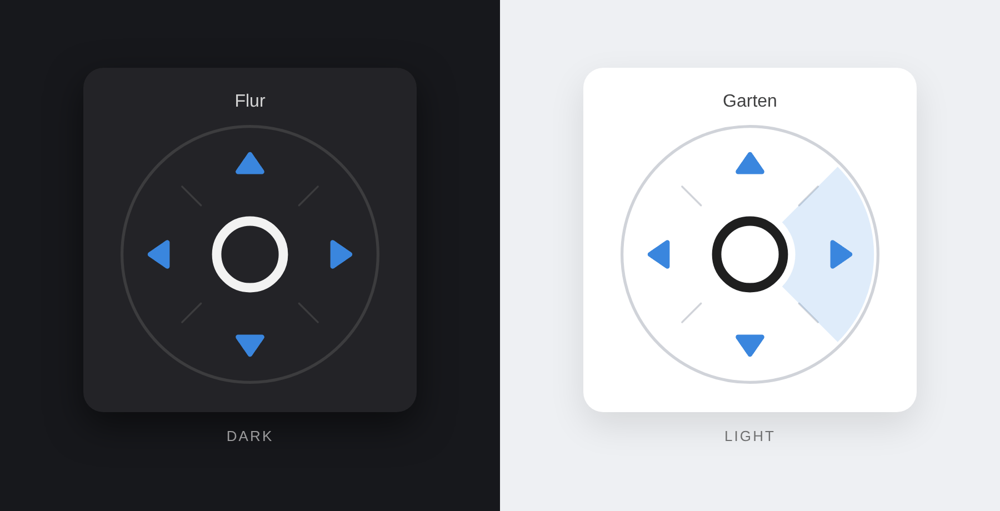

# PTZ D-Pad Card



Runde Pan/Tilt-Steuerung für Home Assistant – hoch, rechts, runter, links im Kreis angeordnet, optionaler Mittelknopf.
Funktioniert universell mit **button / input_button / script / switch**-Entitäten (Tapo Control, Reolink, AiDot, …) oder direkt mit **ONVIF** (`onvif.ptz`).

## Installation über HACS

1. HACS → ⋮ → **Benutzerdefinierte Repositories**
2. URL deines Repos eintragen, Typ **Dashboard** (früher „Lovelace/Plugin“)
3. „PTZ D-Pad Card“ installieren, Browser neu laden (Cache leeren)

Manuell: `dist/ptz-dpad-card.js` nach `/config/www/` kopieren und als Ressource `/local/ptz-dpad-card.js` (JavaScript-Modul) eintragen.

## Minimal – Auto-Erkennung

```yaml
type: custom:ptz-dpad-card
camera: camera.wohnzimmer_hd_stream
```

Die Karte sucht Buttons/Scripts mit hoch/runter/links/rechts (englisch oder deutsch) in Entity-ID, Übersetzungsschlüssel oder Namen – zuerst am **Gerät der Kamera**, dann über den **Basisnamen** (z. B. `camera.flur` → `button.flur_*`, auch wenn die Kamera aus Frigate kommt) und zuletzt im **gleichen Bereich**. Das passt direkt zur **Tapo Control**-Integration. `calibrate` wird automatisch auf die Mitte gelegt. Ist die Kamera eine ONVIF-Kamera ohne solche Buttons, wird `onvif.ptz` benutzt.

## Manuell / beliebige Entitäten

```yaml
type: custom:ptz-dpad-card
name: Flur
up: button.flur_move_up
down: button.flur_move_down
left: button.flur_move_left
right: button.flur_move_right
center: button.flur_calibrate
```

Jede Richtung kann auch eine Aktion sein:

```yaml
type: custom:ptz-dpad-card
camera: camera.garten
left:
  action: perform-action
  perform_action: onvif.ptz
  target: { entity_id: camera.garten }
  data: { pan: LEFT, move_mode: ContinuousMove, continuous_duration: 0.5 }
stop: button.garten_ptz_stop   # wird beim Loslassen gedrückt
```

## Optionen

| Option | Standard | Beschreibung |
|---|---|---|
| `camera` | – | Kamera-Entität, für Auto-Erkennung und Namen |
| `name` | Name der Kamera | Überschrift; `show_name: false` blendet aus |
| `up` `down` `left` `right` `center` | auto | Entity-ID oder Aktion (s. oben) |
| `stop` | auto | Wird beim Loslassen ausgeführt (`stop_on_release: false` zum Abschalten) |
| `repeat_interval` | `0` | ms – wiederholt den Befehl solange gedrückt gehalten wird |
| `mode` | auto | `entity` oder `onvif` erzwingen |
| `onvif_speed` / `onvif_duration` | `0.5` / `0.4` | Nur ONVIF-Modus |
| `debug` | `false` | Schreibt die erkannten Entitäten in die Browser-Konsole (F12) |
| `size` | `220` | Maximale Breite in px |
| `arrow_color` `ring_color` `center_color` | Theme | Farben, z. B. `"#3a86de"` |

Theme-Variablen: `--ptz-arrow-color`, `--ptz-ring-color`, `--ptz-center-color`.

Die Karte hat einen visuellen Editor (Dashboard → Karte hinzufügen → „PTZ D-Pad Card“).

## Tipp: über das Kamerabild legen

```yaml
type: vertical-stack
cards:
  - type: picture-entity
    entity: camera.wohnzimmer_hd_stream
    camera_view: live
    show_state: false
  - type: custom:ptz-dpad-card
    camera: camera.wohnzimmer_hd_stream
    show_name: false
    size: 180
```
